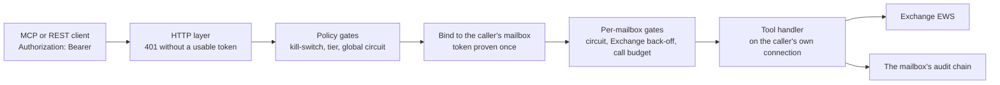

# Serving many mailboxes (bearer mode)

`EWS_AUTH_MODE=bearer` turns one deployment into a service for a whole organisation. Every HTTP
request carries the user's own EWS OAuth2 access token (`Authorization: Bearer <token>`), and the
server acts on that user's mailbox and nothing else. The server holds no Exchange credentials and
runs no background polling. Tokens are issued by your identity provider; the server verifies each
one locally — signature, issuer, audience, expiry — and Exchange checks it again on every request.

This page explains how a call is served, how the server keeps Exchange safe, how to size a
deployment, and which settings matter. For the rules behind it see
[../DESIGN.md](../DESIGN.md#mailboxes); for every setting see [CONFIGURATION.md](CONFIGURATION.md).

## How a call is served

1. **HTTP layer.** The token is verified locally: its signature against your identity provider's
   keys, the algorithm (asymmetric only — never `none` or HMAC), `iss`, `aud` and `exp`/`nbf`
   (60 s skew). No token, a bad signature, a foreign issuer or audience, an expired token, or a
   token without the configured claims gets HTTP `401` with a `WWW-Authenticate: Bearer`
   challenge — before Exchange is contacted. If the provider's keys cannot be fetched, the answer
   is `503`. A
   token Exchange already rejected is refused here too. When `MCP_API_KEY` is set, the service key
   travels in `X-API-Key`, because `Authorization` carries the user's token.
2. **Policy gates** that need no mailbox: the send kill-switch, the capability tier, and the
   process-wide upstream circuit.
3. **Binding.** The call is bound to the caller's *session* — their connections and stored state.
   A token is used for anything stored only after Exchange has accepted it once: one `GetFolder` on
   the mailbox's root, which names the mailbox ("token proof"). Until then nothing on disk or in
   Redis is opened for that mailbox; a forged token naming someone else's mailbox gets `401` and
   touches nothing. A rejected token is remembered until it expires and never sent again.
4. **Per-mailbox gates:** the mailbox's own circuit, any back-off Exchange stated for it, and its
   call budget.
5. **The handler** runs on the caller's own `Account`, through their token, under the caps below.
   Short ids (`m12`) resolve only in the caller's own namespace.
6. **Audit**: one hash-chained record in the mailbox's own chain, naming the mailbox.

No tool takes a mailbox argument. The mailbox always comes from the token.

## Checking the token

| setting | example | what it is for |
|---|---|---|
| `EWS_TOKEN_JWKS_URL` | ADFS: `https://adfs.corp.example/adfs/discovery/keys`; Entra: `https://login.microsoftonline.com/<tenant>/discovery/v2.0/keys` | Where the provider publishes its signing keys (`https://` or `file://`). Fetched with the same TLS trust as Exchange traffic; set `REQUESTS_CA_BUNDLE` for an internal CA. |
| `EWS_TOKEN_ISSUER` | ADFS: usually `http://adfs.corp.example/adfs/services/trust` | Accepted `iss` values, comma-separated. Copy it from a real token. |
| `EWS_TOKEN_AUDIENCE` | `https://mail.corp.example/` | Accepted `aud` values, comma-separated: what your provider puts in EWS tokens. |
| `EWS_TOKEN_ALGORITHMS` | `RS256` | Accepted signing algorithms; asymmetric only. |
| `EWS_TOKEN_VALIDATION` | `signature` | `none` skips the local check and leaves validation to Exchange; use it only when a gateway in front already verified the token. |

Keys are cached and refreshed hourly. A token naming an unknown key id makes the server re-fetch the
keys at most once a minute, so made-up key ids cannot make it hammer your identity provider. Each
token is verified once per pod and remembered until it expires. Access tokens are reused on every
call for their lifetime, so there is no one-time nonce check; replay is limited by expiry and TLS.

## Who the caller is

Two facts come from the verified claims:

| setting | default | what it is for |
|---|---|---|
| `EWS_TOKEN_MAILBOX_CLAIMS` | `email,upn,preferred_username,unique_name` | Where the mailbox address is; the first claim holding an address wins. EWS addresses a mailbox by SMTP address, so this must be the user's primary SMTP address or an address Exchange resolves to the mailbox. Most directories use the UPN as the primary address, and then the default works. |
| `EWS_TOKEN_IDENTITY_CLAIM` | unset | A stable user id, such as `sid`. When set, every token must carry it, and it, not the address, keys the user's stored state, so an address change does not split it. |

If the address claim does not name a mailbox the token can open, the token proof fails with
`auth_failed` and a hint naming `EWS_TOKEN_MAILBOX_CLAIMS`.

## Keeping Exchange safe

Load from this service follows use, not headcount: nothing is polled, and every Exchange request
starts from a user's tool call. Every request also passes a set of limits, all enforced *before*
anything is sent:

| limit | default | when it is hit |
|---|---|---|
| Requests in flight per mailbox (`EWS_MAILBOX_MAX_CONCURRENCY`) | `2` | Further requests for that mailbox wait their turn. |
| Tool calls per mailbox per minute (`EWS_MAILBOX_CALLS_PER_MINUTE`) | `60` | `rate_capped` with `retry_after_s`. |
| Requests in flight per process (`EWS_MAX_CONCURRENCY`) | `32` | A call waits up to `EWS_QUEUE_TIMEOUT_SECONDS` (`10`) for a worker, then gets `throttled` with `retry_after_s`; it is never sent. |
| A back-off Exchange states for a mailbox | as stated, at most 15 min | That mailbox's calls get `throttled` until it ends, on every pod when state is shared. |
| Waiting inside a worker for Exchange (`EWS_RETRY_MAX_WAIT_SECONDS`) | `5` s | Longer back-offs come back to the caller as `throttled` with `retry_after_s` instead of holding a thread. |
| Folders in one `f:all` / `recursive` search (`EWS_FANOUT_MAX_FOLDERS`) | `50` | Further folders are counted in `folders_skipped`. Each folder is one `FindItem`. |
| "Exchange unreachable" in a row across all mailboxes (`EWS_GLOBAL_CIRCUIT_THRESHOLD`) | `20` | Every call pauses for `CIRCUIT_OPEN_SECONDS` (`60`) without contacting Exchange. |
| Sends per mailbox per hour / for everyone (`EWS_MAX_SENDS_PER_HOUR` / `EWS_GLOBAL_MAX_SENDS_PER_HOUR`) | `10` / off | `rate_capped`; checked before a confirm token is spent. |

The hard ceiling is simple to state: **this service never has more than
`pods × EWS_MAX_CONCURRENCY` requests in flight to Exchange**, whatever the number of users. Two
pods at the default are at most 64 concurrent EWS requests. Lower it if your Exchange servers need
more headroom; users then wait or get `throttled` instead of Exchange slowing down for everyone.

Because each request uses the user's own token, each user's calls also count against that user's
own Exchange throttling budget, so one heavy user cannot use up another user's budget.

## Live reads and the optional mirror

Bearer mode reads live by default (`EWS_CACHE_ENABLED=false`). Free-text search (`query`) runs on
Exchange's own search index, which already covers every mailbox and handles Hebrew and English.
Prefer `query` over `subject` filters, which Exchange evaluates by scanning.

`EWS_CACHE_ENABLED=true` adds a small mirror per **active** user:

- **On demand.** A user's tool call starts at most one background refresh of their mirror, and only
  when the last attempt is older than `EWS_CACHE_REFRESH_SECONDS` (`60`). The call never waits for
  it. At most `EWS_CACHE_MAX_CONCURRENT_REFRESHES` (`4`) refreshes run per process; beyond that a
  refresh is skipped until a later call.
- **A window, not the mailbox.** Each refresh lists the last `EWS_CACHE_WINDOW_DAYS` (`14`) of inbox
  and sent items (id, change key and date only, 500 per request, at most
  `EWS_CACHE_MAX_WINDOW_ITEMS` per folder), fetches only new or changed items, and refreshes a 14-day
  calendar window. Its cost follows the window, never the size of the mailbox.
- **Headers and a 300-character snippet** (`EWS_CACHE_BODY_CHARS`). Full bodies and free-text
  search always go live.
- **Deleted after 30 idle minutes** (`EWS_MAILBOX_IDLE_SECONDS`), together with the session.

The mirror makes repeated listings, the morning overview, `waiting_on` and contact history cheap.
Leave it off until live load shows you need it.

## Shared state and pods

Set `EWS_STATE_BACKEND=redis` and `EWS_REDIS_URL` when more than one process serves traffic. Redis
(or Valkey) then holds the small facts every pod must agree on. No mail content goes there.

| what | key prefix | lifetime |
|---|---|---|
| Spent confirmation tokens (single use across pods) | `spent:` | until the token expires |
| Send windows, per mailbox and global | `sends:` | 1 hour |
| Call budgets | `calls:` | 1 minute |
| Back-offs Exchange stated | `backoff:` | as stated |
| `send_draft` idempotency receipts | `idem:` | 48 hours |
| Short-id aliases, one namespace per user | `alias:<key>:` | `EWS_ALIAS_TTL_SECONDS` after last use (7 days) |

All keys are prefixed with `EWS_STATE_PREFIX`. If Redis cannot be reached, spending a confirm token
and reserving a send fail closed (`upstream_unavailable`, nothing done); call budgets, receipts and
aliases degrade open.

Give every pod the same `SEND_CONFIRM_SECRET`. A confirm token is signed by the pod that showed the
preview; with per-pod random secrets, confirming on another pod fails with `confirm_invalid` and
the user has to preview again. The server logs a warning at startup when Redis is configured
without it.

**Pods.** Start with two pods for availability and scale out when `ewsmcp_exchange_workers_busy`
stays near `ewsmcp_exchange_workers_max`. With shared state, any pod can serve any call, so sticky
routing is optional. It only saves work: each pod proves a token once and keeps its own
connections and mirror for the users it serves. If you add stickiness, note that OpenShift route
cookies work only when the MCP client keeps cookies; balancing by source address helps only when
clients are not all behind one gateway. The per-mailbox concurrency cap is per pod.

**Sessions per pod.** `EWS_MAX_MAILBOXES` (`2000`) bounds sessions per process; past it the least
recently used idle sessions close first. Set it at or above the number of users one pod serves at a
time.

## Sizing for 70,000 users

Assume 2–5 % of users are active at once: 1,400–3,500 sessions across the deployment.

- **Exchange:** at most `pods × EWS_MAX_CONCURRENCY` requests in flight (64 with two pods), on
  average one to three EWS requests per tool call, plus one token proof per user per token
  lifetime per pod.
- **Memory:** a session is a few connections and small bookkeeping; thousands fit in one pod.
- **Mirror disk (if enabled):** roughly 1–3 MB per active user with a 14-day window and 300-character
  snippets: a few GB across the deployment, on any fast local volume (`emptyDir` or tmpfs) under
  `DATA_DIR`. Nothing for idle users.
- **Redis:** kilobytes per active user.
- **Audit:** one chain per mailbox per pod under `DATA_DIR/mailboxes/<key>/audit`. Persist and ship
  it to your log store; `scripts/verify_audit_chain.py --all DATA_DIR` verifies every chain.

## Mail written to steer the assistant

Anyone can send your users mail, so message bodies, meeting descriptions and attachments may carry
instructions aimed at the assistant. In bearer mode:

- Text hidden from the reader by inline CSS or the `hidden` attribute is removed from bodies, meeting
  descriptions and HTML attachments; the response says `hidden_text_removed: true`.
- Sender-written text arrives wrapped in `<untrusted-content id="<nonce>">` markers whose nonce the
  sender cannot guess, and the MCP `initialize` instructions tell the client to treat it as data.
- The step that matters most is yours: **configure the MCP client to ask the human before any tool
  that sends, deletes, or changes meetings or rules runs.** A two-phase confirm token proves only
  that the content did not change between preview and execution; the model can echo it back on its
  own.

See [SAFETY.md](SAFETY.md#mail-written-to-steer-the-assistant).

## Settings for bearer mode

| setting | bearer default | meaning |
|---|---|---|
| `EWS_AUTH_MODE` | `bearer` | Serve many mailboxes from callers' tokens (requires `MCP_TRANSPORT=http`). |
| `EWS_TOKEN_MAILBOX_CLAIMS` | `email,upn,preferred_username,unique_name` | Claims holding the mailbox address. |
| `EWS_TOKEN_IDENTITY_CLAIM` | unset | Stable user id claim (e.g. `sid`) that keys stored state. |
| `EWS_TOKEN_VALIDATION` | `signature` | Verify tokens locally (`none` leaves it to Exchange). |
| `EWS_TOKEN_JWKS_URL` / `EWS_TOKEN_ISSUER` / `EWS_TOKEN_AUDIENCE` | required with `signature` | The provider's keys, accepted `iss`, accepted `aud`. |
| `EWS_TOKEN_ALGORITHMS` | `RS256` | Accepted signing algorithms (asymmetric only). |
| `EWS_MAX_CONCURRENCY` | `32` | Exchange requests in flight per process. |
| `EWS_QUEUE_TIMEOUT_SECONDS` | `10` | Longest wait for a worker before a call is shed. |
| `EWS_MAILBOX_MAX_CONCURRENCY` | `2` | Exchange requests in flight per mailbox per process. |
| `EWS_MAILBOX_CALLS_PER_MINUTE` | `60` | Tool calls per mailbox per minute. |
| `EWS_MAILBOX_IDLE_SECONDS` | `1800` | Idle time before a session (and its mirror) is closed. |
| `EWS_MAX_MAILBOXES` | `2000` | Sessions per process before idle ones are evicted. |
| `EWS_GLOBAL_CIRCUIT_THRESHOLD` | `20` | Consecutive "Exchange unreachable" outcomes that pause every call. |
| `EWS_RETRY_MAX_WAIT_SECONDS` | `5` | Longest in-worker wait on an Exchange back-off. |
| `EWS_FANOUT_MAX_FOLDERS` | `50` | Folders per multi-folder search. |
| `EWS_GLOBAL_MAX_SENDS_PER_HOUR` | `0` (off) | Sends per hour across all mailboxes. |
| `EWS_STATE_BACKEND` / `EWS_REDIS_URL` / `EWS_STATE_PREFIX` | `local` / – / `ewsmcp` | Shared state across processes. |
| `EWS_ALIAS_TTL_SECONDS` | `604800` | How long short ids stay resolvable in Redis after last use. |
| `EWS_CACHE_ENABLED` | `false` | The on-demand window mirror. |
| `EWS_CACHE_WINDOW_DAYS` / `EWS_CACHE_BODY_CHARS` | `14` / `300` | Mirror window and snippet length. |
| `EWS_CACHE_REFRESH_SECONDS` / `EWS_CACHE_MAX_CONCURRENT_REFRESHES` / `EWS_CACHE_MAX_WINDOW_ITEMS` | `60` / `4` / `1000` | Mirror refresh pacing and bounds. |
| `EWS_MARK_UNTRUSTED_CONTENT` | `true` | Wrap sender-written text in nonce markers. |

Bearer mode refuses `MCP_TRANSPORT=stdio` and `EWS_SEMANTIC_INDEX=pgvector` (that index has no
mailbox column and would mix users' mail).

## Watching it

`/metrics` adds, in bearer mode, aggregate gauges and counters only — never per-mailbox labels:
`ewsmcp_mailbox_sessions`, `ewsmcp_mailbox_tokens`, `ewsmcp_calls_in_flight`,
`ewsmcp_rejected_tokens`, `ewsmcp_session_evictions_total`, `ewsmcp_exchange_workers_busy`,
`ewsmcp_exchange_workers_max`, `ewsmcp_calls_shed_total`, `ewsmcp_upstream_circuit_open`, and the
mirror's `ewsmcp_mirror_refreshes_total` / `_skipped_total` / `_failed_total`. The existing
`ewsmcp_errors_total{code="throttled"|"rate_capped"}` shows limits being hit. `/readyz` answers
`200` with `state: per_mailbox` as soon as the process is up: with no credentials of its own, the
server cannot probe Exchange.

## Known limits

- Search-result snippets come from Exchange's plain-text rendering without the HTML, so they are
  neither filtered for hidden text nor marked (they are at most 200 characters).
- Hiding through `<style>` blocks or classes, and text coloured like its background, is not
  detected.
- `include_html=true` returns the raw HTML, unfiltered and unmarked, by design.
- Caps on concurrency per mailbox are per pod; the call budget, back-offs and send caps are global
  with Redis.
- An audit chain exists per mailbox per pod; there is no single cross-pod chain.
